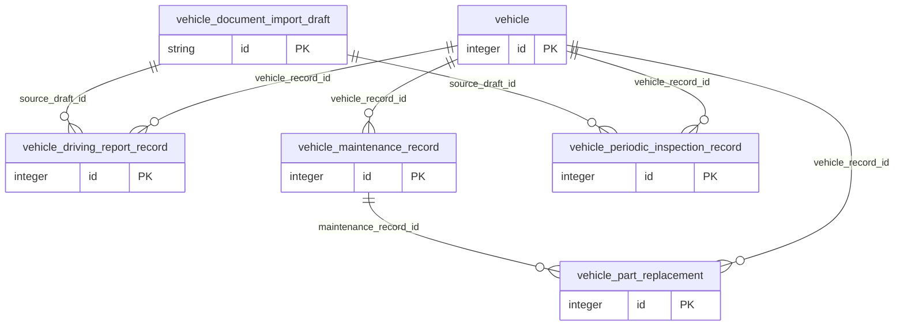

# Database schema

Generated from SQLAlchemy metadata by `python tools/generate_schema_docs.py`.
Relationships below are declared foreign keys; company scoping is enforced by application queries.

Tables: 65

## analysis_input_epoch

| Column | Type | Nullable | Primary key | Foreign key |
| --- | --- | --- | --- | --- |
| company_code | VARCHAR(50) | False | True |  |
| bucket | VARCHAR(80) | False | True |  |
| revision | BIGINT | False | False |  |

## analysis_input_read_cache

| Column | Type | Nullable | Primary key | Foreign key |
| --- | --- | --- | --- | --- |
| company_code | VARCHAR(50) | False | True |  |
| vehicle_record_id | INTEGER | False | True |  |
| context_hash | VARCHAR(64) | False | False |  |
| input_revision | BIGINT | False | False |  |
| projection_json | TEXT | False | False |  |
| computed_at | DATETIME | False | False |  |
| expires_at | DATETIME | False | False |  |

## audit_log

| Column | Type | Nullable | Primary key | Foreign key |
| --- | --- | --- | --- | --- |
| id | INTEGER | False | True |  |
| company_code | VARCHAR(50) | False | False |  |
| username | VARCHAR(100) | True | False |  |
| action | VARCHAR(100) | False | False |  |
| target_type | VARCHAR(100) | True | False |  |
| target_id | VARCHAR(100) | True | False |  |
| detail | TEXT | True | False |  |
| ip_address | VARCHAR(100) | True | False |  |
| created_at | VARCHAR(20) | False | False |  |

## checklist

| Column | Type | Nullable | Primary key | Foreign key |
| --- | --- | --- | --- | --- |
| id | INTEGER | False | True |  |
| company_code | VARCHAR(50) | False | False |  |
| name | VARCHAR(200) | False | False |  |
| target | VARCHAR(100) | True | False |  |
| frequency_value | VARCHAR(20) | True | False |  |
| frequency_unit | VARCHAR(20) | True | False |  |
| display_type | VARCHAR(20) | True | False |  |
| print_portrait | BOOLEAN | False | False |  |
| print_half_month | BOOLEAN | False | False |  |
| reminder_enabled | BOOLEAN | False | False |  |
| reminder_time | VARCHAR(5) | False | False |  |
| items_json | TEXT | True | False |  |
| version_history_json | TEXT | True | False |  |
| active | BOOLEAN | False | False |  |
| notify_users_json | TEXT | True | False |  |

## checklist_event

| Column | Type | Nullable | Primary key | Foreign key |
| --- | --- | --- | --- | --- |
| id | INTEGER | False | True |  |
| company_code | VARCHAR(50) | False | False |  |
| result_type | VARCHAR(20) | False | False |  |
| result_id | INTEGER | False | False |  |
| event_type | VARCHAR(50) | False | False |  |
| actor_username | VARCHAR(50) | True | False |  |
| actor_name | VARCHAR(100) | True | False |  |
| detail_json | TEXT | True | False |  |
| created_at | VARCHAR(30) | False | False |  |

## checklist_result

| Column | Type | Nullable | Primary key | Foreign key |
| --- | --- | --- | --- | --- |
| id | INTEGER | False | True |  |
| company_code | VARCHAR(50) | False | False |  |
| checklist_id | INTEGER | False | False |  |
| target_type | VARCHAR(50) | True | False |  |
| target_user | VARCHAR(100) | True | False |  |
| target_username | VARCHAR(50) | True | False |  |
| target_vehicle_record_id | INTEGER | True | False | vehicle.id |
| target_office | VARCHAR(100) | True | False |  |
| checked_by | VARCHAR(100) | True | False |  |
| checked_by_username | VARCHAR(50) | True | False |  |
| checked_date | VARCHAR(30) | True | False |  |
| status | VARCHAR(30) | True | False |  |
| approved_by | VARCHAR(100) | True | False |  |
| approved_by_username | VARCHAR(50) | True | False |  |
| approved_date | VARCHAR(30) | True | False |  |
| reject_reason | TEXT | True | False |  |
| approvals_json | TEXT | True | False |  |
| notify_users_json | TEXT | True | False |  |
| answers_json | TEXT | True | False |  |
| checklist_snapshot_json | TEXT | True | False |  |

## company

| Column | Type | Nullable | Primary key | Foreign key |
| --- | --- | --- | --- | --- |
| id | INTEGER | False | True |  |
| company_code | VARCHAR(50) | False | False |  |
| company_name | VARCHAR(100) | False | False |  |
| vehicle_limit | INTEGER | True | False |  |
| active | BOOLEAN | True | False |  |

## company_usage_summary

| Column | Type | Nullable | Primary key | Foreign key |
| --- | --- | --- | --- | --- |
| id | INTEGER | False | True |  |
| company_code | VARCHAR(50) | False | False |  |
| user_count | INTEGER | False | False |  |
| vehicle_count | INTEGER | False | False |  |
| login_count | INTEGER | False | False |  |
| checklist_result_count | INTEGER | False | False |  |
| last_used_at | VARCHAR(20) | True | False |  |
| updated_at | VARCHAR(20) | True | False |  |

## delivery_place

| Column | Type | Nullable | Primary key | Foreign key |
| --- | --- | --- | --- | --- |
| id | INTEGER | False | True |  |
| company_code | VARCHAR(50) | False | False |  |
| name | VARCHAR(100) | False | False |  |

## document_queue_schedule

| Column | Type | Nullable | Primary key | Foreign key |
| --- | --- | --- | --- | --- |
| id | INTEGER | False | True |  |
| version | INTEGER | False | False |  |
| last_company | VARCHAR(50) | True | False |  |

## domain_schema_revision

| Column | Type | Nullable | Primary key | Foreign key |
| --- | --- | --- | --- | --- |
| revision | VARCHAR(80) | False | True |  |
| applied_at | DATETIME | False | False |  |

## driver

| Column | Type | Nullable | Primary key | Foreign key |
| --- | --- | --- | --- | --- |
| id | INTEGER | False | True |  |
| company_code | VARCHAR(50) | False | False |  |
| employee_id | VARCHAR(50) | False | False |  |
| name | VARCHAR(100) | False | False |  |
| role | VARCHAR(50) | True | False |  |
| office | VARCHAR(100) | True | False |  |
| safe_start_date | VARCHAR(20) | True | False |  |
| vehicles_json | TEXT | True | False |  |
| licenses_json | TEXT | True | False |  |

## driving_report_reader

| Column | Type | Nullable | Primary key | Foreign key |
| --- | --- | --- | --- | --- |
| id | INTEGER | False | True |  |
| company_code | VARCHAR(50) | False | False |  |
| report_id | INTEGER | False | False | vehicle_driving_report_record.id |
| username | VARCHAR(50) | False | False |  |
| user_id | INTEGER | False | False | user.id |
| identity_hash | VARCHAR(64) | False | False |  |
| confirmed_by | VARCHAR(50) | False | False |  |
| confirmed_at | VARCHAR(40) | False | False |  |

## driving_report_reflection

| Column | Type | Nullable | Primary key | Foreign key |
| --- | --- | --- | --- | --- |
| id | INTEGER | False | True |  |
| company_code | VARCHAR(50) | False | False |  |
| cache_key | VARCHAR(64) | False | False |  |
| status | VARCHAR(20) | False | False |  |
| result_json | TEXT | False | False |  |
| created_at | VARCHAR(40) | False | False |  |
| updated_at | VARCHAR(40) | False | False |  |

## inspection_expiry_alert_delivery

| Column | Type | Nullable | Primary key | Foreign key |
| --- | --- | --- | --- | --- |
| id | INTEGER | False | True |  |
| company_code | VARCHAR(50) | False | False |  |
| vehicle_record_id | INTEGER | False | False | vehicle.id |
| expiry_date | VARCHAR(10) | False | False |  |
| notification_id | INTEGER | False | False | notification.id |
| target_username | VARCHAR(50) | False | False |  |
| office | VARCHAR(100) | False | False |  |
| phase | VARCHAR(30) | False | False |  |
| bucket | INTEGER | False | False |  |
| sent_day | VARCHAR(10) | False | False |  |
| ended_status | VARCHAR(16) | True | False |  |

## inspection_plan_alert_delivery

| Column | Type | Nullable | Primary key | Foreign key |
| --- | --- | --- | --- | --- |
| id | INTEGER | False | True |  |
| company_code | VARCHAR(50) | False | False |  |
| plan_id | INTEGER | False | False | vehicle_inspection_plan.id |
| notification_id | INTEGER | False | False | notification.id |
| target_username | VARCHAR(50) | False | False |  |
| office | VARCHAR(100) | False | False |  |
| revision | VARCHAR(64) | False | False |  |
| phase | VARCHAR(30) | False | False |  |
| bucket | INTEGER | False | False |  |
| sent_day | VARCHAR(10) | False | False |  |
| ended_status | VARCHAR(16) | True | False |  |

## inspection_plan_alert_run

| Column | Type | Nullable | Primary key | Foreign key |
| --- | --- | --- | --- | --- |
| company_code | VARCHAR(50) | False | True |  |
| checked_at | VARCHAR(40) | False | False |  |
| local_day | VARCHAR(10) | False | False |  |
| report_json | TEXT | False | False |  |
| input_signature | VARCHAR(64) | False | False |  |

## license_type

| Column | Type | Nullable | Primary key | Foreign key |
| --- | --- | --- | --- | --- |
| id | INTEGER | False | True |  |
| company_code | VARCHAR(50) | False | False |  |
| name | VARCHAR(100) | False | False |  |

## maintenance_knowledge_document

| Column | Type | Nullable | Primary key | Foreign key |
| --- | --- | --- | --- | --- |
| id | VARCHAR(36) | False | True |  |
| company_code | VARCHAR(50) | False | False |  |
| checksum | VARCHAR(64) | False | False |  |
| filename | VARCHAR(255) | False | False |  |
| original_data | BLOB | False | False |  |
| mimetype | VARCHAR(50) | False | False |  |
| knowledge_ids_json | TEXT | False | False |  |
| extraction_json | TEXT | False | False |  |
| created_by | VARCHAR(50) | False | False |  |
| created_at | VARCHAR(30) | False | False |  |

## maintenance_knowledge_rule_extraction

| Column | Type | Nullable | Primary key | Foreign key |
| --- | --- | --- | --- | --- |
| id | INTEGER | False | True |  |
| company_code | VARCHAR(50) | False | False |  |
| document_id | VARCHAR(36) | False | False | maintenance_knowledge_document.id |
| extraction_version | INTEGER | False | False |  |
| document_checksum | VARCHAR(64) | False | False |  |
| knowledge_ids_json | TEXT | False | False |  |
| extraction_json | TEXT | False | False |  |
| created_at | VARCHAR(30) | False | False |  |

## manual

| Column | Type | Nullable | Primary key | Foreign key |
| --- | --- | --- | --- | --- |
| id | INTEGER | False | True |  |
| company_code | VARCHAR(50) | False | False |  |
| title | VARCHAR(200) | False | False |  |
| category | VARCHAR(100) | True | False |  |
| filename | VARCHAR(200) | True | False |  |

## master_display_order

| Column | Type | Nullable | Primary key | Foreign key |
| --- | --- | --- | --- | --- |
| id | INTEGER | False | True |  |
| company_code | VARCHAR(50) | False | False |  |
| kind | VARCHAR(30) | False | False |  |
| ordered_ids_json | TEXT | False | False |  |
| version | INTEGER | False | False |  |

## news

| Column | Type | Nullable | Primary key | Foreign key |
| --- | --- | --- | --- | --- |
| id | INTEGER | False | True |  |
| company_code | VARCHAR(50) | True | False |  |
| title | VARCHAR(200) | False | False |  |
| message | TEXT | True | False |  |
| files_json | TEXT | True | False |  |
| target_type | VARCHAR(50) | True | False |  |
| target_value | VARCHAR(100) | True | False |  |
| created_at | VARCHAR(20) | True | False |  |

## notification

| Column | Type | Nullable | Primary key | Foreign key |
| --- | --- | --- | --- | --- |
| id | INTEGER | False | True |  |
| company_code | VARCHAR(50) | True | False |  |
| target_user | VARCHAR(100) | False | False |  |
| target_username | VARCHAR(50) | True | False |  |
| title | VARCHAR(200) | False | False |  |
| message | TEXT | True | False |  |
| link | VARCHAR(200) | True | False |  |
| files_json | TEXT | True | False |  |
| read | BOOLEAN | True | False |  |
| created_at | VARCHAR(20) | True | False |  |
| deleted_at | DATETIME | True | False |  |
| workflow_context_json | TEXT | True | False |  |

## office

| Column | Type | Nullable | Primary key | Foreign key |
| --- | --- | --- | --- | --- |
| id | INTEGER | False | True |  |
| company_code | VARCHAR(50) | False | False |  |
| name | VARCHAR(100) | False | False |  |

## patrol_content_type

| Column | Type | Nullable | Primary key | Foreign key |
| --- | --- | --- | --- | --- |
| id | INTEGER | False | True |  |
| company_code | VARCHAR(50) | False | False |  |
| name | VARCHAR(100) | False | False |  |

## patrol_result

| Column | Type | Nullable | Primary key | Foreign key |
| --- | --- | --- | --- | --- |
| id | INTEGER | False | True |  |
| company_code | VARCHAR(50) | False | False |  |
| created_by_username | VARCHAR(100) | True | False |  |
| created_by_name | VARCHAR(100) | True | False |  |
| date | VARCHAR(20) | True | False |  |
| office | VARCHAR(100) | True | False |  |
| delivery_place | VARCHAR(100) | True | False |  |
| category | VARCHAR(50) | True | False |  |
| content_type | VARCHAR(50) | True | False |  |
| target_type | VARCHAR(50) | True | False |  |
| target_user | VARCHAR(100) | True | False |  |
| target_username | VARCHAR(50) | True | False |  |
| content | TEXT | True | False |  |
| files_json | TEXT | True | False |  |
| countermeasure | TEXT | True | False |  |
| countermeasure_files_json | TEXT | True | False |  |
| countermeasure_by | VARCHAR(100) | True | False |  |
| countermeasure_by_username | VARCHAR(50) | True | False |  |
| countermeasure_due_date | VARCHAR(20) | True | False |  |
| approval_status | VARCHAR(30) | True | False |  |
| reject_reason | TEXT | True | False |  |

## periodic_inspection_issue

| Column | Type | Nullable | Primary key | Foreign key |
| --- | --- | --- | --- | --- |
| id | INTEGER | False | True |  |
| company_code | VARCHAR(50) | False | False |  |
| vehicle_record_id | INTEGER | False | False | vehicle.id |
| inspection_record_id | INTEGER | False | False | vehicle_periodic_inspection_record.id |
| item_key | VARCHAR(30) | False | False |  |
| evidence_json | TEXT | False | False |  |
| description | TEXT | False | False |  |
| status | VARCHAR(30) | False | False |  |
| maintenance_record_id | INTEGER | True | False | vehicle_maintenance_record.id |
| version | INTEGER | False | False |  |
| created_by | VARCHAR(50) | False | False |  |
| created_at | VARCHAR(40) | False | False |  |

## periodic_inspection_issue_event

| Column | Type | Nullable | Primary key | Foreign key |
| --- | --- | --- | --- | --- |
| id | INTEGER | False | True |  |
| company_code | VARCHAR(50) | False | False |  |
| issue_id | INTEGER | False | False | periodic_inspection_issue.id |
| action | VARCHAR(30) | False | False |  |
| actor | VARCHAR(50) | False | False |  |
| performed_date | VARCHAR(20) | True | False |  |
| note | TEXT | False | False |  |
| maintenance_record_id | INTEGER | True | False | vehicle_maintenance_record.id |
| created_at | VARCHAR(40) | False | False |  |
| notification_ids_json | TEXT | False | False |  |

## periodic_inspection_proposal

| Column | Type | Nullable | Primary key | Foreign key |
| --- | --- | --- | --- | --- |
| id | INTEGER | False | True |  |
| company_code | VARCHAR(50) | False | False |  |
| inspection_record_id | INTEGER | False | False | vehicle_periodic_inspection_record.id |
| input_hash | VARCHAR(64) | False | False |  |
| run_token | VARCHAR(36) | False | False |  |
| status | VARCHAR(20) | False | False |  |
| result_json | TEXT | False | False |  |
| error | VARCHAR(40) | True | False |  |
| updated_at | VARCHAR(40) | False | False |  |

## public_knowledge_catalog

| Column | Type | Nullable | Primary key | Foreign key |
| --- | --- | --- | --- | --- |
| id | INTEGER | False | True |  |
| company_code | VARCHAR(50) | False | False |  |
| next_check | DATETIME | False | False |  |
| last_checked | DATETIME | True | False |  |
| lease_token | VARCHAR(36) | True | False |  |
| lease_until | DATETIME | True | False |  |
| last_error | VARCHAR(200) | True | False |  |
| requested_scope_hash | VARCHAR(64) | True | False |  |

## public_knowledge_file

| Column | Type | Nullable | Primary key | Foreign key |
| --- | --- | --- | --- | --- |
| id | INTEGER | False | True |  |
| company_code | VARCHAR(50) | False | False |  |
| url | VARCHAR(500) | False | False |  |
| title | VARCHAR(240) | False | False |  |
| priority | INTEGER | False | False |  |
| available | BOOLEAN | False | False |  |
| next_check | DATETIME | False | False |  |
| last_checked | DATETIME | True | False |  |
| checksum | VARCHAR(64) | True | False |  |
| document_id | VARCHAR(36) | True | False |  |
| last_import_month | VARCHAR(7) | True | False |  |
| status | VARCHAR(30) | False | False |  |
| last_error | VARCHAR(200) | True | False |  |

## push_subscription

| Column | Type | Nullable | Primary key | Foreign key |
| --- | --- | --- | --- | --- |
| id | INTEGER | False | True |  |
| company_code | VARCHAR(50) | False | False |  |
| username | VARCHAR(50) | False | False |  |
| endpoint | TEXT | False | False |  |
| p256dh | TEXT | False | False |  |
| auth | TEXT | False | False |  |
| created_at | VARCHAR(20) | False | False |  |

## user

| Column | Type | Nullable | Primary key | Foreign key |
| --- | --- | --- | --- | --- |
| id | INTEGER | False | True |  |
| company_code | VARCHAR(50) | False | False |  |
| username | VARCHAR(50) | False | False |  |
| password | VARCHAR(255) | False | False |  |
| password_history_json | TEXT | False | False |  |
| password_changed_at | VARCHAR(20) | True | False |  |
| last_login_at | VARCHAR(20) | True | False |  |
| failed_login_count | INTEGER | False | False |  |
| login_locked | BOOLEAN | False | False |  |
| last_name | VARCHAR(100) | False | False |  |
| first_name | VARCHAR(100) | True | False |  |
| role | VARCHAR(20) | True | False |  |
| office | VARCHAR(100) | True | False |  |
| dashboard_settings_json | TEXT | True | False |  |
| timezone | VARCHAR(100) | False | False |  |
| email_address | VARCHAR(255) | True | False |  |
| profile_image | VARCHAR(255) | True | False |  |
| email_notify_enabled | BOOLEAN | False | False |  |
| mfa_code_hash | VARCHAR(255) | True | False |  |
| mfa_code_expires_at | VARCHAR(20) | True | False |  |
| mfa_code_sent_at | VARCHAR(20) | True | False |  |
| pending_email_address | VARCHAR(255) | True | False |  |
| email_change_code_hash | VARCHAR(255) | True | False |  |
| email_change_code_expires_at | VARCHAR(20) | True | False |  |

## vehicle

| Column | Type | Nullable | Primary key | Foreign key |
| --- | --- | --- | --- | --- |
| id | INTEGER | False | True |  |
| company_code | VARCHAR(50) | False | False |  |
| plate_area | VARCHAR(50) | True | False |  |
| plate_class | VARCHAR(50) | True | False |  |
| plate_kana | VARCHAR(10) | True | False |  |
| plate_number | VARCHAR(50) | True | False |  |
| chassis_number | VARCHAR(100) | True | False |  |
| model_code | VARCHAR(100) | True | False |  |
| engine_code | VARCHAR(100) | True | False |  |
| first_registration_date | VARCHAR(20) | True | False |  |
| manufacturer | VARCHAR(100) | True | False |  |
| body_type | VARCHAR(100) | True | False |  |
| gross_vehicle_weight | INTEGER | True | False |  |
| max_payload | INTEGER | True | False |  |
| type | VARCHAR(100) | True | False |  |
| office | VARCHAR(100) | True | False |  |
| inspection_expiry | VARCHAR(20) | True | False |  |
| deleted | BOOLEAN | True | False |  |

## vehicle_analysis_evaluation

| Column | Type | Nullable | Primary key | Foreign key |
| --- | --- | --- | --- | --- |
| id | INTEGER | False | True |  |
| company_code | VARCHAR(50) | False | False |  |
| vehicle_record_id | INTEGER | False | False | vehicle.id |
| proposal_key | VARCHAR(64) | False | False |  |
| proposal_revision | VARCHAR(64) | False | False |  |
| verdict | VARCHAR(20) | False | False |  |
| comment | TEXT | False | False |  |
| snapshot_json | TEXT | False | False |  |
| created_by | VARCHAR(50) | False | False |  |
| created_at | VARCHAR(30) | False | False |  |

## vehicle_analysis_feedback

| Column | Type | Nullable | Primary key | Foreign key |
| --- | --- | --- | --- | --- |
| id | INTEGER | False | True |  |
| company_code | VARCHAR(50) | False | False |  |
| vehicle_record_id | INTEGER | False | False | vehicle.id |
| proposal_key | VARCHAR(64) | False | False |  |
| proposal_revision | VARCHAR(64) | False | False |  |
| status | VARCHAR(20) | False | False |  |
| comment | TEXT | False | False |  |
| snapshot_json | TEXT | False | False |  |
| created_by | VARCHAR(50) | False | False |  |
| created_at | VARCHAR(30) | False | False |  |

## vehicle_checklist_notify_setting

| Column | Type | Nullable | Primary key | Foreign key |
| --- | --- | --- | --- | --- |
| id | INTEGER | False | True |  |
| company_code | VARCHAR(50) | False | False |  |
| checklist_id | INTEGER | False | False |  |
| vehicle_record_id | INTEGER | False | False | vehicle.id |
| notify_users_json | TEXT | True | False |  |

## vehicle_checklist_result

| Column | Type | Nullable | Primary key | Foreign key |
| --- | --- | --- | --- | --- |
| id | INTEGER | False | True |  |
| company_code | VARCHAR(50) | False | False |  |
| checklist_id | INTEGER | False | False |  |
| vehicle_record_id | INTEGER | False | False | vehicle.id |
| year | VARCHAR(10) | True | False |  |
| month | VARCHAR(10) | True | False |  |
| day | VARCHAR(10) | True | False |  |
| checked_by | VARCHAR(100) | True | False |  |
| checked_by_username | VARCHAR(50) | True | False |  |
| checked_date | VARCHAR(30) | True | False |  |
| status | VARCHAR(30) | True | False |  |
| approved_by | VARCHAR(100) | True | False |  |
| approved_by_username | VARCHAR(50) | True | False |  |
| approved_date | VARCHAR(30) | True | False |  |
| reject_reason | TEXT | True | False |  |
| approvals_json | TEXT | True | False |  |
| notify_users_json | TEXT | True | False |  |
| answers_json | TEXT | True | False |  |
| checklist_snapshot_json | TEXT | True | False |  |
| operation_judgment_json | TEXT | True | False |  |

## vehicle_coupling

| Column | Type | Nullable | Primary key | Foreign key |
| --- | --- | --- | --- | --- |
| id | INTEGER | False | True |  |
| company_code | VARCHAR(50) | False | False |  |
| towing_vehicle_id | INTEGER | False | False | vehicle.id |
| trailer_vehicle_id | INTEGER | False | False | vehicle.id |
| kind | VARCHAR(20) | False | False |  |
| created_at | VARCHAR(30) | False | False |  |
| created_by_username | VARCHAR(50) | False | False |  |

## vehicle_document_import_draft

| Column | Type | Nullable | Primary key | Foreign key |
| --- | --- | --- | --- | --- |
| id | VARCHAR(36) | False | True |  |
| batch_id | VARCHAR(36) | False | False |  |
| company_code | VARCHAR(50) | False | False |  |
| created_by_username | VARCHAR(50) | False | False |  |
| document_type | VARCHAR(30) | False | False |  |
| source_filename | VARCHAR(255) | False | False |  |
| source_file | BLOB | False | False |  |
| source_sha256 | VARCHAR(64) | False | False |  |
| preview_json | TEXT | False | False |  |
| status | VARCHAR(20) | False | False |  |
| result_json | TEXT | False | False |  |
| created_at | DATETIME | False | False |  |
| completed_at | DATETIME | True | False |  |

## vehicle_document_source

| Column | Type | Nullable | Primary key | Foreign key |
| --- | --- | --- | --- | --- |
| company_code | VARCHAR(50) | False | True |  |
| sha256 | VARCHAR(64) | False | True |  |
| content | BLOB | False | False |  |
| created_at | DATETIME | False | False |  |

## vehicle_driving_report_record

| Column | Type | Nullable | Primary key | Foreign key |
| --- | --- | --- | --- | --- |
| id | INTEGER | False | True |  |
| company_code | VARCHAR(50) | False | False |  |
| vehicle_record_id | INTEGER | False | False | vehicle.id |
| operation_record_id | INTEGER | True | False | vehicle_operation_record.id |
| report_number | VARCHAR(100) | True | False |  |
| operation_date | VARCHAR(20) | False | False |  |
| mileage | NUMERIC(14, 2) | True | False |  |
| content | TEXT | True | False |  |
| details_json | TEXT | False | False |  |
| source_draft_id | VARCHAR(36) | False | False | vehicle_document_import_draft.id |
| source_record_index | INTEGER | False | False |  |
| created_by_username | VARCHAR(50) | False | False |  |
| created_at | DATETIME | False | False |  |

## vehicle_import_pending

| Column | Type | Nullable | Primary key | Foreign key |
| --- | --- | --- | --- | --- |
| id | VARCHAR(36) | False | True |  |
| company_code | VARCHAR(50) | False | False |  |
| match_key | VARCHAR(255) | False | False |  |
| status | VARCHAR(20) | False | False |  |
| identity_json | TEXT | False | False |  |
| resolved_vehicle_id | INTEGER | True | False | vehicle.id |
| resolution_json | TEXT | False | False |  |
| created_by_username | VARCHAR(50) | False | False |  |
| created_at | DATETIME | False | False |  |
| resolved_at | DATETIME | True | False |  |

## vehicle_import_pending_record

| Column | Type | Nullable | Primary key | Foreign key |
| --- | --- | --- | --- | --- |
| id | VARCHAR(36) | False | True |  |
| company_code | VARCHAR(50) | False | False |  |
| pending_id | VARCHAR(36) | False | False | vehicle_import_pending.id |
| source_kind | VARCHAR(30) | False | False |  |
| record_key | VARCHAR(64) | False | False |  |
| operation_draft_id | VARCHAR(36) | True | False | vehicle_operation_import_draft.id |
| document_draft_id | VARCHAR(36) | True | False | vehicle_document_import_draft.id |
| source_record_index | INTEGER | False | False |  |
| record_date | VARCHAR(30) | True | False |  |
| payload_json | TEXT | False | False |  |
| status | VARCHAR(20) | False | False |  |
| vehicle_record_id | INTEGER | True | False | vehicle.id |
| result_json | TEXT | False | False |  |
| created_by_username | VARCHAR(50) | False | False |  |
| created_at | DATETIME | False | False |  |
| applied_at | DATETIME | True | False |  |

## vehicle_inspection_execution

| Column | Type | Nullable | Primary key | Foreign key |
| --- | --- | --- | --- | --- |
| id | INTEGER | False | True |  |
| company_code | VARCHAR(50) | False | False |  |
| vehicle_record_id | INTEGER | False | False | vehicle.id |
| kind | VARCHAR(30) | False | False |  |
| performed_date | VARCHAR(10) | False | False |  |
| plan_id | INTEGER | True | False | vehicle_inspection_plan.id |
| source_record_id | INTEGER | True | False | vehicle_periodic_inspection_record.id |
| next_month | VARCHAR(7) | True | False |  |
| factory | VARCHAR(200) | False | False |  |
| note | VARCHAR(1000) | False | False |  |
| created_by | VARCHAR(50) | False | False |  |
| created_at | VARCHAR(40) | False | False |  |

## vehicle_inspection_execution_evidence

| Column | Type | Nullable | Primary key | Foreign key |
| --- | --- | --- | --- | --- |
| execution_id | INTEGER | False | True | vehicle_inspection_execution.id |
| company_code | VARCHAR(50) | False | False |  |
| new_expiry | VARCHAR(10) | True | False |  |
| previous_expiry | VARCHAR(10) | True | False |  |
| document_id | VARCHAR(36) | True | False | vehicle_document_import_draft.id |
| confirmation | VARCHAR(1000) | False | False |  |
| attachment_confirmation | VARCHAR(1000) | True | False |  |
| attached_at | VARCHAR(40) | True | False |  |
| attached_by | VARCHAR(50) | True | False |  |

## vehicle_inspection_plan

| Column | Type | Nullable | Primary key | Foreign key |
| --- | --- | --- | --- | --- |
| id | INTEGER | False | True |  |
| company_code | VARCHAR(50) | False | False |  |
| vehicle_record_id | INTEGER | False | False | vehicle.id |
| kind | VARCHAR(30) | False | False |  |
| period_key | VARCHAR(7) | False | False |  |
| planned_month | VARCHAR(7) | False | False |  |
| reservation_date | VARCHAR(10) | True | False |  |
| document_date | VARCHAR(10) | True | False |  |
| factory | VARCHAR(200) | False | False |  |
| note | VARCHAR(1000) | False | False |  |
| source | VARCHAR(30) | False | False |  |
| source_record_id | INTEGER | True | False | vehicle_periodic_inspection_record.id |
| completed_record_id | INTEGER | True | False | vehicle_periodic_inspection_record.id |
| status | VARCHAR(20) | False | False |  |
| version | INTEGER | False | False |  |
| updated_by | VARCHAR(50) | False | False |  |
| updated_at | VARCHAR(40) | False | False |  |

## vehicle_inspection_plan_event

| Column | Type | Nullable | Primary key | Foreign key |
| --- | --- | --- | --- | --- |
| id | INTEGER | False | True |  |
| company_code | VARCHAR(50) | False | False |  |
| plan_id | INTEGER | False | False | vehicle_inspection_plan.id |
| action | VARCHAR(30) | False | False |  |
| detail_json | TEXT | False | False |  |
| created_at | VARCHAR(40) | False | False |  |
| created_by | VARCHAR(50) | False | False |  |

## vehicle_karte_analysis

| Column | Type | Nullable | Primary key | Foreign key |
| --- | --- | --- | --- | --- |
| id | INTEGER | False | True |  |
| company_code | VARCHAR(50) | False | False |  |
| vehicle_record_id | INTEGER | False | False | vehicle.id |
| status | VARCHAR(30) | False | False |  |
| input_hash | VARCHAR(64) | True | False |  |
| result_json | TEXT | False | False |  |
| last_analyzed_at | DATETIME | True | False |  |
| next_analysis_at | DATETIME | True | False |  |
| request_reason | VARCHAR(200) | True | False |  |
| lease_token | VARCHAR(36) | True | False |  |
| lease_expires_at | DATETIME | True | False |  |
| last_error | VARCHAR(500) | True | False |  |

## vehicle_karte_note

| Column | Type | Nullable | Primary key | Foreign key |
| --- | --- | --- | --- | --- |
| id | INTEGER | False | True |  |
| company_code | VARCHAR(50) | False | False |  |
| vehicle_record_id | INTEGER | False | False | vehicle.id |
| content | TEXT | False | False |  |
| version | INTEGER | False | False |  |
| updated_by_username | VARCHAR(50) | True | False |  |
| updated_at | VARCHAR(30) | True | False |  |

## vehicle_maintenance_document

| Column | Type | Nullable | Primary key | Foreign key |
| --- | --- | --- | --- | --- |
| id | VARCHAR(36) | False | True |  |
| company_code | VARCHAR(50) | False | False |  |
| vehicle_record_id | INTEGER | False | False | vehicle.id |
| maintenance_record_id | INTEGER | True | False | vehicle_maintenance_record.id |
| inspection_record_id | INTEGER | True | False | vehicle_periodic_inspection_record.id |
| source_draft_id | VARCHAR(36) | False | False | vehicle_document_import_draft.id |
| source_record_index | INTEGER | False | False |  |
| pending_record_id | VARCHAR(36) | True | False | vehicle_import_pending_record.id |
| related_document_id | VARCHAR(36) | True | False | vehicle_maintenance_document.id |
| payload_json | TEXT | False | False |  |
| decision_json | TEXT | False | False |  |
| financial_status | VARCHAR(20) | False | False |  |
| parts_status | VARCHAR(20) | False | False |  |
| created_by_username | VARCHAR(100) | False | False |  |
| created_at | DATETIME | False | False |  |
| reviewed_by_username | VARCHAR(100) | True | False |  |
| reviewed_at | DATETIME | True | False |  |

## vehicle_maintenance_inspection_link

| Column | Type | Nullable | Primary key | Foreign key |
| --- | --- | --- | --- | --- |
| id | INTEGER | False | True |  |
| company_code | VARCHAR(50) | False | False |  |
| vehicle_record_id | INTEGER | False | False | vehicle.id |
| maintenance_record_id | INTEGER | False | False | vehicle_maintenance_record.id |
| inspection_result_id | INTEGER | False | False | vehicle_checklist_result.id |
| defect_no | INTEGER | False | False |  |

## vehicle_maintenance_knowledge

| Column | Type | Nullable | Primary key | Foreign key |
| --- | --- | --- | --- | --- |
| id | INTEGER | False | True |  |
| company_code | VARCHAR(50) | False | False |  |
| title | VARCHAR(150) | False | False |  |
| part_name | VARCHAR(100) | False | False |  |
| manufacturer | VARCHAR(100) | False | False |  |
| model_code | VARCHAR(100) | False | False |  |
| conditions | TEXT | False | False |  |
| guidance | TEXT | False | False |  |
| source_kind | VARCHAR(30) | False | False |  |
| source_reference | TEXT | False | False |  |
| provider | VARCHAR(150) | False | False |  |
| valid_from | VARCHAR(10) | False | False |  |
| valid_until | VARCHAR(10) | False | False |  |
| status | VARCHAR(20) | False | False |  |
| created_by | VARCHAR(50) | False | False |  |
| created_at | VARCHAR(30) | False | False |  |
| confirmed_by | VARCHAR(50) | True | False |  |
| confirmed_at | VARCHAR(30) | True | False |  |
| retired_by | VARCHAR(50) | True | False |  |
| retired_at | VARCHAR(30) | True | False |  |
| retirement_reason | TEXT | True | False |  |

## vehicle_maintenance_record

| Column | Type | Nullable | Primary key | Foreign key |
| --- | --- | --- | --- | --- |
| id | INTEGER | False | True |  |
| company_code | VARCHAR(50) | False | False |  |
| vehicle_record_id | INTEGER | False | False | vehicle.id |
| category | VARCHAR(50) | True | False |  |
| status | VARCHAR(50) | True | False |  |
| entry_date | VARCHAR(20) | True | False |  |
| completion_date | VARCHAR(20) | True | False |  |
| mileage | NUMERIC(14, 2) | True | False |  |
| content | TEXT | True | False |  |
| symptom | TEXT | True | False |  |
| cause | TEXT | True | False |  |
| temporary_action | TEXT | True | False |  |
| repair_content | TEXT | True | False |  |
| maintenance_company | VARCHAR(200) | True | False |  |
| maintenance_person | VARCHAR(100) | True | False |  |
| repair_hours | NUMERIC(10, 2) | True | False |  |
| invoice_number | VARCHAR(100) | True | False |  |
| invoice_date | VARCHAR(20) | True | False |  |
| invoice_details_json | TEXT | False | False |  |
| labor_cost | NUMERIC(14, 2) | True | False |  |
| parts_cost | NUMERIC(14, 2) | True | False |  |
| other_cost | NUMERIC(14, 2) | True | False |  |
| tax_amount | NUMERIC(14, 2) | True | False |  |
| total_cost | NUMERIC(14, 2) | True | False |  |
| line_items_json | TEXT | False | False |  |
| files_json | TEXT | False | False |  |
| notes | TEXT | True | False |  |
| created_by_username | VARCHAR(50) | True | False |  |
| created_at | VARCHAR(30) | True | False |  |
| updated_by_username | VARCHAR(50) | True | False |  |
| updated_at | VARCHAR(30) | True | False |  |

## vehicle_maintenance_record_event

| Column | Type | Nullable | Primary key | Foreign key |
| --- | --- | --- | --- | --- |
| id | INTEGER | False | True |  |
| company_code | VARCHAR(50) | False | False |  |
| vehicle_record_id | INTEGER | False | False | vehicle.id |
| maintenance_record_id | INTEGER | False | False | vehicle_maintenance_record.id |
| action | VARCHAR(50) | False | False |  |
| status_before | VARCHAR(50) | True | False |  |
| status_after | VARCHAR(50) | True | False |  |
| changes_json | TEXT | False | False |  |
| created_by_username | VARCHAR(100) | True | False |  |
| created_at | VARCHAR(30) | False | False |  |

## vehicle_operation_import_draft

| Column | Type | Nullable | Primary key | Foreign key |
| --- | --- | --- | --- | --- |
| id | VARCHAR(36) | False | True |  |
| company_code | VARCHAR(50) | False | False |  |
| created_by_username | VARCHAR(50) | False | False |  |
| source_filename | VARCHAR(255) | False | False |  |
| source_file | BLOB | False | False |  |
| selection_json | TEXT | False | False |  |
| status | VARCHAR(20) | False | False |  |
| result_json | TEXT | False | False |  |
| created_at | DATETIME | False | False |  |
| completed_at | DATETIME | True | False |  |

## vehicle_operation_record

| Column | Type | Nullable | Primary key | Foreign key |
| --- | --- | --- | --- | --- |
| id | INTEGER | False | True |  |
| company_code | VARCHAR(50) | False | False |  |
| vehicle_record_id | INTEGER | False | False | vehicle.id |
| report_number | VARCHAR(100) | False | False |  |
| operation_date | VARCHAR(20) | False | False |  |
| source_vehicle_code | VARCHAR(100) | True | False |  |
| source_vehicle_number | VARCHAR(100) | True | False |  |
| departure_at | VARCHAR(30) | True | False |  |
| arrival_at | VARCHAR(30) | True | False |  |
| departure_meter | NUMERIC(14, 2) | True | False |  |
| arrival_meter | NUMERIC(14, 2) | True | False |  |
| distance | NUMERIC(14, 2) | True | False |  |
| source_row_json | TEXT | False | False |  |
| source_filename | VARCHAR(255) | True | False |  |
| imported_by_username | VARCHAR(50) | True | False |  |
| imported_at | VARCHAR(30) | True | False |  |

## vehicle_operation_vehicle_mapping

| Column | Type | Nullable | Primary key | Foreign key |
| --- | --- | --- | --- | --- |
| id | INTEGER | False | True |  |
| company_code | VARCHAR(50) | False | False |  |
| source_vehicle_code | VARCHAR(100) | False | False |  |
| source_vehicle_number | VARCHAR(100) | False | False |  |
| vehicle_record_id | INTEGER | False | False | vehicle.id |
| confirmed_by_username | VARCHAR(50) | False | False |  |
| confirmed_at | DATETIME | False | False |  |

## vehicle_part_replacement

| Column | Type | Nullable | Primary key | Foreign key |
| --- | --- | --- | --- | --- |
| id | INTEGER | False | True |  |
| company_code | VARCHAR(50) | False | False |  |
| vehicle_record_id | INTEGER | False | False | vehicle.id |
| maintenance_record_id | INTEGER | False | False | vehicle_maintenance_record.id |
| part_name | VARCHAR(200) | False | False |  |
| part_number | VARCHAR(100) | True | False |  |
| quantity | NUMERIC(14, 2) | False | False |  |
| replacement_date | VARCHAR(20) | False | False |  |
| mileage | NUMERIC(14, 2) | True | False |  |
| cost | NUMERIC(14, 2) | True | False |  |
| notes | TEXT | True | False |  |
| created_by_username | VARCHAR(100) | True | False |  |
| created_at | VARCHAR(30) | False | False |  |
| updated_by_username | VARCHAR(100) | True | False |  |
| updated_at | VARCHAR(30) | True | False |  |

## vehicle_part_replacement_source

| Column | Type | Nullable | Primary key | Foreign key |
| --- | --- | --- | --- | --- |
| id | INTEGER | False | True |  |
| company_code | VARCHAR(50) | False | False |  |
| maintenance_record_id | INTEGER | False | False | vehicle_maintenance_record.id |
| replacement_id | INTEGER | False | False | vehicle_part_replacement.id |
| source_line_index | INTEGER | False | False |  |
| source_line_version | VARCHAR(64) | False | False |  |

## vehicle_patrol

| Column | Type | Nullable | Primary key | Foreign key |
| --- | --- | --- | --- | --- |
| id | INTEGER | False | True |  |
| company_code | VARCHAR(50) | False | False |  |
| vehicle_record_id | INTEGER | False | False | vehicle.id |
| occurred_date | VARCHAR(20) | True | False |  |
| category | VARCHAR(100) | True | False |  |
| priority | VARCHAR(50) | True | False |  |
| content | TEXT | True | False |  |
| cause | TEXT | True | False |  |
| temporary_action | TEXT | True | False |  |
| repair_content | TEXT | True | False |  |
| status | VARCHAR(50) | True | False |  |
| repair_date | VARCHAR(20) | True | False |  |
| repair_person | VARCHAR(100) | True | False |  |
| repair_time | VARCHAR(50) | True | False |  |
| parts | TEXT | True | False |  |
| cost | VARCHAR(50) | True | False |  |

## vehicle_periodic_inspection_record

| Column | Type | Nullable | Primary key | Foreign key |
| --- | --- | --- | --- | --- |
| id | INTEGER | False | True |  |
| company_code | VARCHAR(50) | False | False |  |
| vehicle_record_id | INTEGER | False | False | vehicle.id |
| inspection_type | VARCHAR(30) | False | False |  |
| inspection_date | VARCHAR(20) | False | False |  |
| completion_date | VARCHAR(20) | True | False |  |
| next_inspection_date | VARCHAR(20) | True | False |  |
| mileage | NUMERIC(14, 2) | True | False |  |
| inspection_company | VARCHAR(200) | True | False |  |
| inspector_name | VARCHAR(100) | True | False |  |
| content | TEXT | True | False |  |
| details_json | TEXT | False | False |  |
| source_draft_id | VARCHAR(36) | False | False | vehicle_document_import_draft.id |
| source_record_index | INTEGER | False | False |  |
| created_by_username | VARCHAR(50) | False | False |  |
| created_at | DATETIME | False | False |  |

## vehicle_type

| Column | Type | Nullable | Primary key | Foreign key |
| --- | --- | --- | --- | --- |
| id | INTEGER | False | True |  |
| company_code | VARCHAR(50) | False | False |  |
| name | VARCHAR(100) | False | False |  |

## vehicle_type_import_mapping

| Column | Type | Nullable | Primary key | Foreign key |
| --- | --- | --- | --- | --- |
| id | INTEGER | False | True |  |
| company_code | VARCHAR(50) | False | False |  |
| excel_value | VARCHAR(100) | False | False |  |
| vehicle_type_name | VARCHAR(100) | False | False |  |
